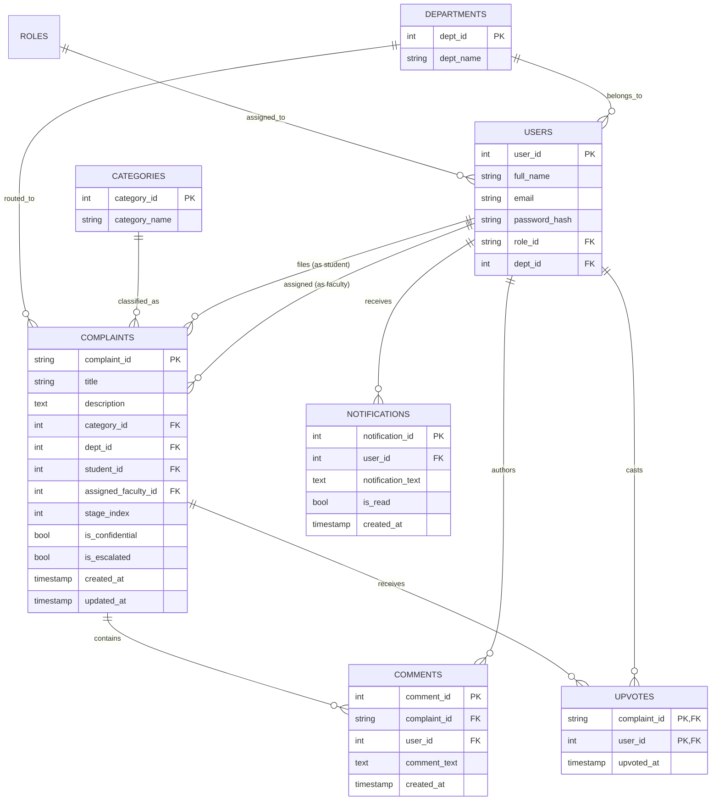

# JKLU Grievance Desk — DBMS Architecture & Relational Design

## 1. Overview
The **JKLU Grievance Desk** is a full-featured campus complaint management system designed to provide transparent, multi-stage grievance resolution for students, faculty department heads, and university administration.

This document details the **Relational Database Management System (DBMS)** architecture, Entity-Relationship (ER) model, normalization justifications (1NF to 3NF), and analytical SQL queries.

---

## 2. Entity-Relationship (ER) Model



---

## 3. Relational Normalization (1NF → 2NF → 3NF)

1. **First Normal Form (1NF)**:
   - All attributes contain atomic values (no comma-separated lists of attachments, upvotes, or comments in a single column).
   - Comments, upvotes, and notifications are isolated in their own respective tables.
   - Each table has a defined primary key (`complaint_id`, `user_id`, composite `(complaint_id, user_id)` for upvotes).

2. **Second Normal Form (2NF)**:
   - All non-key attributes are fully functionally dependent on the entire primary key.
   - In `upvotes`, `upvoted_at` depends on the full composite key `(complaint_id, user_id)`.

3. **Third Normal Form (3NF)**:
   - Transitive dependencies are removed.
   - For example, `dept_name` is not stored redundantly in `complaints` or `users`; instead, it references `departments(dept_id)`.
   - `category_name` is normalized into `categories(category_id)`.

---

## 4. Key Analytical SQL Queries

### A. Grievance Resolution Rate by Department
```sql
SELECT 
    d.dept_name,
    COUNT(c.complaint_id) AS total_complaints,
    SUM(CASE WHEN c.stage_index = 3 THEN 1 ELSE 0 END) AS resolved_count,
    ROUND(100.0 * SUM(CASE WHEN c.stage_index = 3 THEN 1 ELSE 0 END) / COUNT(c.complaint_id), 1) AS resolution_rate_pct
FROM departments d
LEFT JOIN complaints c ON d.dept_id = c.dept_id
GROUP BY d.dept_id, d.dept_name
ORDER BY resolution_rate_pct DESC;
```

### B. Most Upvoted Campus Concerns
```sql
SELECT 
    c.complaint_id,
    c.title,
    cat.category_name,
    d.dept_name,
    COUNT(u.user_id) AS upvote_count,
    CASE c.stage_index
        WHEN 0 THEN 'Submitted'
        WHEN 1 THEN 'In Review'
        WHEN 2 THEN 'Action Taken'
        WHEN 3 THEN 'Resolved'
    END AS current_stage
FROM complaints c
JOIN categories cat ON c.category_id = cat.category_id
JOIN departments d ON c.dept_id = d.dept_id
LEFT JOIN upvotes u ON c.complaint_id = u.complaint_id
WHERE c.is_confidential = 0
GROUP BY c.complaint_id, c.title, cat.category_name, d.dept_name, c.stage_index
ORDER BY upvote_count DESC;
```

### C. Active Faculty Workload Queue
```sql
SELECT 
    u.full_name AS faculty_name,
    d.dept_name,
    COUNT(c.complaint_id) AS pending_complaints
FROM users u
JOIN departments d ON u.dept_id = d.dept_id
LEFT JOIN complaints c ON u.user_id = c.assigned_faculty_id AND c.stage_index < 3
WHERE u.role_id = 'faculty'
GROUP BY u.user_id, u.full_name, d.dept_name
ORDER BY pending_complaints DESC;
```
